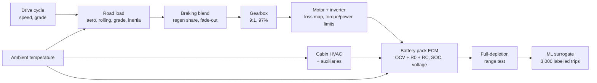
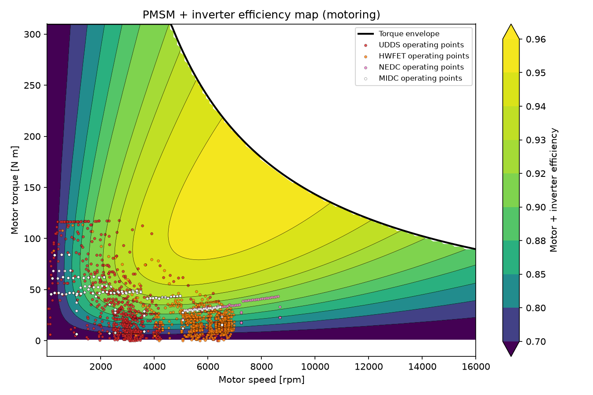
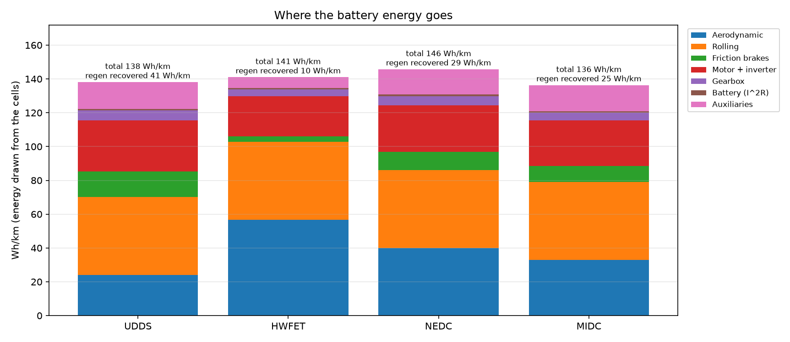
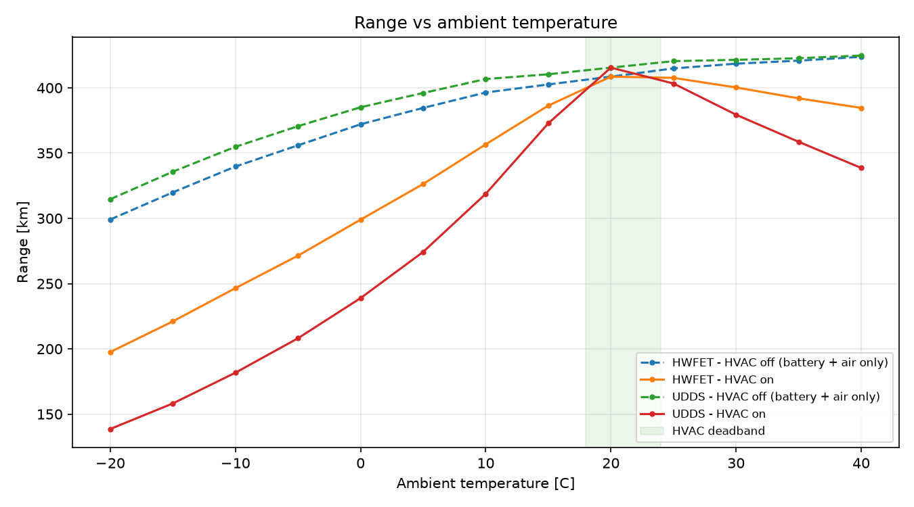
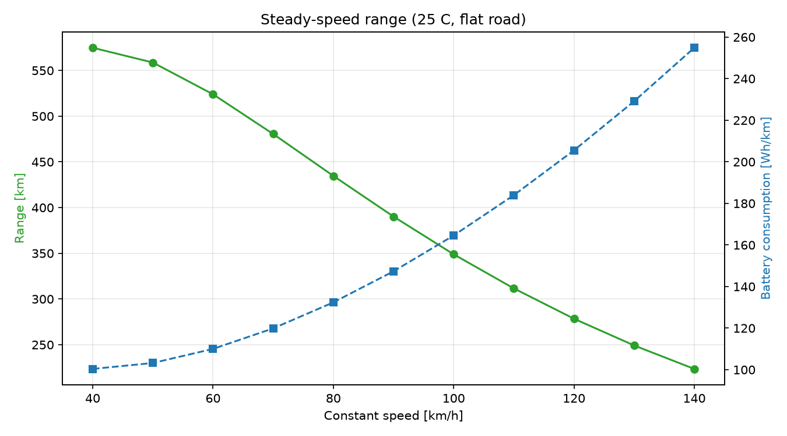
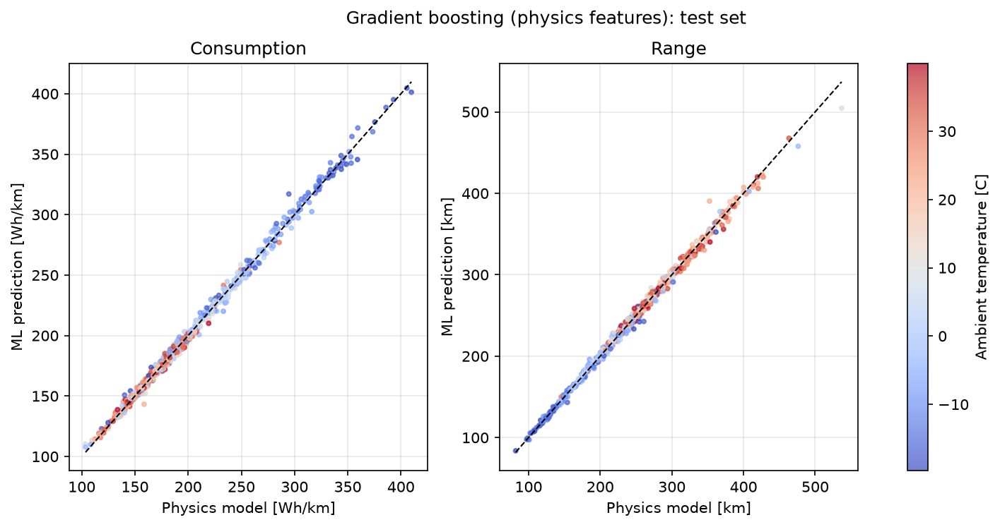
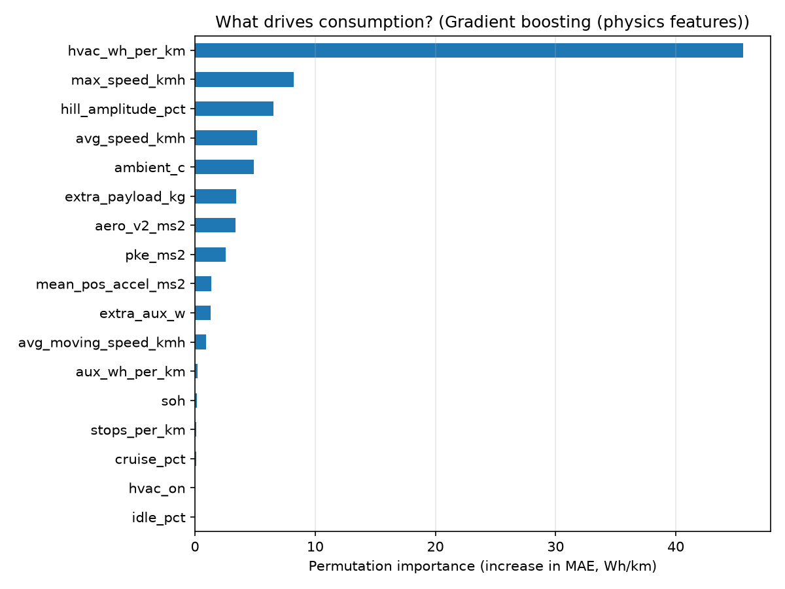

# EV Range Predictor

**Physics-based electric-vehicle energy and range model over standard drive cycles, with a machine-learning surrogate and an interactive dashboard.**

The model follows the full energy path of a battery-electric car — road load, braking, gearbox, motor and inverter, battery pack and cabin climate — and runs a dynamometer-style range test: a drive cycle is repeated until the usable state-of-charge window is used up. A gradient-boosting model trained on 3,000 physics-labelled trips then predicts range within about 1.4% of the physics model in a fraction of the time.

  

<!-- Dashboard screenshot: save it as docs/images/dashboard.png, then remove the comment markers around the next line.

-->

## Highlights

- **Validated drive cycles:** official EPA UDDS and HWFET traces, ECE-15 and EUDC, with NEDC and the Indian MIDC built from them. Computed distances match published values within 0.7%.
- **Detailed powertrain:** PMSM + inverter loss map (peak 95.6%) with a torque/power envelope, 9:1 gearbox, regenerative braking with low-speed fade-out and a power limit.
- **Battery equivalent-circuit model:** 96s3p NMC pack (174 Ah, 57.8 kWh usable), OCV(SOC) + R0 + RC, voltage limits, Arrhenius temperature dependence and cold-capacity loss.
- **Closed energy balance:** every watt-hour drawn from the cells is accounted for as a loss (aero, rolling, friction brakes, motor, gearbox, battery, auxiliaries). A test checks the balance to 1e-6.
- **Real-world sensitivity:** temperature with cabin heating or air-conditioning, payload, rolling hills, motorway speed and battery ageing, plus six realistic scenarios.
- **ML surrogate:** five models compared on 3,000 synthetic trips; physics-informed features cut linear-model error from 26 to 3.4 Wh/km; an extrapolation test shows where the ML stops being trustworthy.
- **Interactive dashboard and CLI:** Streamlit app with physics and ML predictions side by side, and validity warnings when inputs leave the ML training range.

## Model



| Component | Model |
|---|---|
| Road load | F = ½ρC<sub>d</sub>Av² + mgC<sub>rr</sub>cosθ + mg·sinθ + m<sub>eff</sub>·dv/dt |
| Motor + inverter | P<sub>loss</sub> = k<sub>c</sub>T² + k<sub>i</sub>ω + k<sub>w</sub>ω³ + C, with \|T\| ≤ min(T<sub>peak</sub>, P<sub>peak</sub>/ω) |
| Battery | P = (V<sub>oc</sub> − V<sub>RC</sub>)I − R<sub>0</sub>I², SOC from coulomb counting, current limited to keep V within cell limits |
| Temperature | ρ from the ideal-gas law; R(T) = R<sub>25</sub>·exp(E<sub>a</sub>/R<sub>g</sub>·(1/T − 1/T<sub>25</sub>)); capacity factor table |
| Cabin HVAC | heating load UA·ΔT / COP, cooling load (UA·ΔT + solar) / COP, 3 °C deadband around 21 °C |

Vehicle: generic compact EV, 1,800 kg + 80 kg driver, C<sub>d</sub> 0.28, A 2.30 m², C<sub>rr</sub> 0.009, 150 kW / 310 N·m motor. All parameters are in [`configs/`](configs).

## Results

### Drive-cycle validation

| Cycle | Duration [s] | Distance [km] | Published [km] | Difference |
|---|---|---|---|---|
| UDDS (city) | 1369 | 11.990 | 11.99 | 0.00% |
| HWFET (highway) | 765 | 16.507 | 16.51 | −0.02% |
| NEDC | 1180 | 10.931 | 11.007 | −0.69% |
| MIDC (India) | 1180 | 10.586 | – | – |

### Consumption and range (25 °C, no HVAC, new battery)

| Cycle | Simple model [Wh/km] | Detailed model [Wh/km] | Range [km] | Motor efficiency | Regen share |
|---|---|---|---|---|---|
| UDDS | 123.9 | 137.3 | 418 | 86.9% | 23.1% |
| HWFET | 127.6 | 140.2 | 409 | 85.2% | 6.4% |
| NEDC | 131.5 | 144.7 | 397 | 85.9% | 16.7% |
| MIDC | 121.5 | 135.7 | 423 | 84.7% | 15.5% |

The simple model uses a constant 90% drivetrain efficiency; adding the motor map, gearbox and battery losses lowers range by 8–10%.

### Where the energy goes [Wh/km]

| Cycle | Aero | Rolling | Friction brakes | Motor + inverter | Gearbox | Battery | Auxiliaries | Regen recovered |
|---|---|---|---|---|---|---|---|---|
| UDDS | 24.0 | 46.1 | 15.2 | 30.1 | 6.0 | 0.9 | 15.9 | 41.2 |
| HWFET | 56.7 | 46.1 | 3.3 | 23.6 | 4.1 | 0.9 | 6.4 | 9.5 |
| NEDC | 39.9 | 46.1 | 10.7 | 27.7 | 5.3 | 1.0 | 15.0 | 28.9 |
| MIDC | 32.9 | 46.1 | 9.5 | 26.9 | 4.7 | 0.7 | 15.5 | 24.8 |





### Real-world scenarios [range, km]

| Scenario | HVAC [W] | UDDS | HWFET | Motorway 120 km/h |
|---|---|---|---|---|
| Mild day, 25 °C | 180 | 403 | 408 | 278 |
| Summer, 35 °C + A/C | 780 | 359 (−11%) | 392 (−4%) | 278 (0%) |
| Winter, −10 °C + heater, 2 people | 4,200 | 180 (−55%) | 244 (−40%) | 188 (−32%) |
| Family trip, +300 kg, 4% hills | 180 | 351 (−13%) | 359 (−12%) | 263 (−6%) |
| Aged battery, SOH 80% | 180 | 322 (−20%) | 325 (−20%) | 222 (−20%) |
| Worst case: winter, loaded, hills, aged | 4,200 | 132 (−67%) | 173 (−57%) | 137 (−51%) |





### ML surrogate (3,000 trips, 80/20 split, 5-fold CV)

| Model | MAE [Wh/km] | R² | Range MAE [km] | Range MAPE |
|---|---|---|---|---|
| Linear regression (raw features) | 26.07 | 0.694 | 36.99 | 13.95% |
| Ridge regression (physics features) | 3.43 | 0.994 | 4.44 | 1.74% |
| Random forest (raw features) | 5.57 | 0.984 | 7.31 | 2.85% |
| Gradient boosting (raw features) | 3.22 | 0.994 | 4.05 | 1.61% |
| **Gradient boosting (physics features)** | **2.77** | **0.996** | **3.42** | **1.38%** |

**Extrapolation test** — train without one cycle family, predict it (consumption MAPE):

| Held-out family | Gradient boosting | Ridge (physics features) | Random forest |
|---|---|---|---|
| Constant speed | 15.1% | **3.0%** | 16.5% |
| HWFET | **4.6%** | 5.8% | 9.8% |
| MIDC | **1.7%** | 8.6% | 4.2% |
| NEDC | **3.7%** | 20.9% | 4.2% |
| UDDS | **2.2%** | 9.1% | 3.0% |





## Key findings

1. **Winter heating hurts city driving most.** A 4.2 kW PTC heater at −10 °C adds about 133 Wh/km at UDDS's 31.5 km/h average speed, roughly doubling consumption (−55% range), but only about 35 Wh/km at 120 km/h (−32%). A heat pump (COP 2.5) recovers much of the loss.
2. **City and highway end up close for opposite reasons.** UDDS loses more to the motor (low-load operation) and friction brakes but recovers 41 Wh/km through regen; HWFET has little braking but 2.4× the aerodynamic loss.
3. **Rolling resistance is constant per km** (46.1 Wh/km on every cycle): it depends on mass, not speed. Aero grows with v², so steady-speed range falls from 575 km at 40 km/h to 224 km at 140 km/h.
4. **Hills cost energy even with zero net climb.** At 2% grade regen recovers almost everything; at 8% range drops 13–16% because energy passes through the motor and gearbox twice and steep descents exceed the 70 kW regen limit.
5. **Physics-informed features make simple ML competitive.** Adding distance-weighted mean v² and HVAC energy per km takes linear-model error from 26 to 3.4 Wh/km.
6. **Tree models do not extrapolate.** Trained without constant-speed trips, gradient boosting is 15% off on them, while the physics-feature ridge model stays within 3%. Training data must cover the driving styles to be predicted.
7. **HVAC energy per km is the strongest single driver** of consumption in the ML model, ahead of top speed, hills and temperature.

## Quick start

```bash
git clone https://github.com/BalajiS61/ev-range-predictor.git
cd ev-range-predictor
python -m venv .venv
.venv\Scripts\activate            # Windows  (macOS/Linux: source .venv/bin/activate)
pip install -e ".[dev,app]"
python scripts/download_cycles.py # official EPA drive cycles into data/cycles/
```

Run the pipeline step by step:

```bash
python scripts/step1_demo.py         # road-load physics check
python scripts/step2_cycles.py       # cycle validation, statistics, energy per cycle
python scripts/step3_powertrain.py   # motor map, battery, losses, full-depletion range
python scripts/step4_sensitivity.py  # temperature, speed, payload, hills, ageing (~1 min)
python scripts/step5_ml.py           # 3,000-trip dataset and ML models (a few minutes)
python scripts/export_figures.py     # copy key plots into docs/images/
pytest -q                            # 57 tests
```

Predict a single trip, or open the dashboard:

```bash
python scripts/predict_range.py --cycle udds --ambient -5 --payload 150
python scripts/predict_range.py --cycle constant --speed 120 --ambient -10 --heat-pump
streamlit run app/app.py
```

## Project structure

```
ev-range-predictor/
├── app/app.py                 Streamlit dashboard
├── configs/                   vehicle, powertrain/battery and environment parameters (YAML)
├── data/cycles/               EPA drive-cycle files (downloaded)
├── docs/                      technical report and README figures
├── scripts/                   step scripts, downloader, CLI predictor, figure export
├── src/evrange/
│   ├── vehicle.py             vehicle parameters and validation
│   ├── dynamics.py            road-load forces and simple energy model
│   ├── cycles.py              cycle container, file loading, joining, resampling
│   ├── cycle_library.py       standard cycles, download, NEDC/MIDC composites
│   ├── cycle_stats.py         kinematic cycle statistics
│   ├── powertrain.py          gearbox and motor loss model
│   ├── battery.py             pack equivalent-circuit model
│   ├── ev_model.py            full model, energy balance, range test
│   ├── environment.py         air density, cabin HVAC, battery temperature effects
│   ├── scenarios.py           scenarios, sweeps, EPA-style label estimate
│   ├── ml.py                  dataset generation, models, predictor
│   └── app_logic.py           dashboard and CLI computations
└── tests/                     57 pytest tests
```

## Assumptions and limitations

- **Generic parameters.** The vehicle, motor and battery values are literature-typical for a compact EV, not a specific production car, and have not been calibrated against measured data. Absolute ranges are therefore indicative; the relative effects are the main result.
- **Backward-facing, quasi-static model.** The vehicle follows the speed trace exactly unless the motor limit is reached; no driver model, tyre slip or transient thermal dynamics.
- **Battery at ambient temperature.** No pack heating, cooling or preconditioning, so cold-weather losses are an upper bound for cars with thermal management.
- **Steady-state cabin HVAC.** No cabin warm-up transient, which matters on short winter trips.
- **WLTC not included.** Its second-by-second trace is not freely downloadable from the source used; the code already supports it if `data/cycles/wltp3b.txt` is added.
- **The ML model is a surrogate of this physics model**, trained on synthetic data. It reproduces the model quickly; it is not trained on real vehicle logs.

## Roadmap

- Calibrate parameters against a published vehicle (EPA test-car coefficients and label values).
- Add WLTC Class 3b from UNECE GTR 15 Annex 1.
- Battery thermal model with preconditioning, and a cabin warm-up transient.
- Train and validate the ML model on real trip data (e.g. CAN logs).

## Data sources

- US EPA, *Dynamometer Drive Schedules* — UDDS, HWFET, ECE-15 and EUDC 1 Hz traces (public domain).
- UNECE Regulation No. 83 (NEDC) and GTR No. 15 (WLTP) for cycle definitions and reference values.
- J. Larminie, J. Lowry, *Electric Vehicle Technology Explained*, Wiley — motor loss model.

## Author

**Balaji S** — Electronics & Communication Engineering, RV College of Engineering, Bengaluru.
GitHub: [BalajiS61](https://github.com/BalajiS61) · Email: balajis6143mail@gmail.com

Licensed under the [MIT License](LICENSE). A detailed write-up is in [docs/technical_report.md](docs/technical_report.md).
